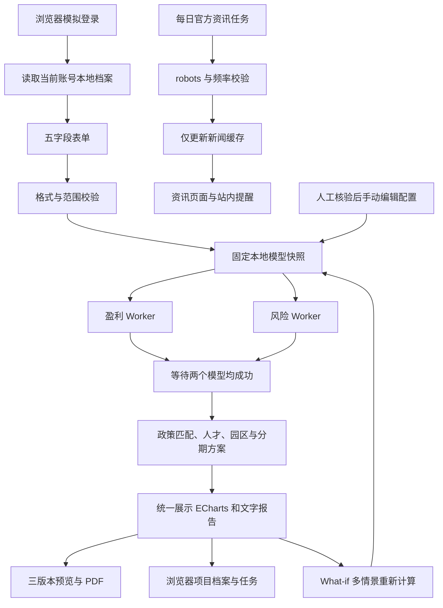

# 架构与业务流程

模型不导入资讯模块；新闻模块不修改模型文件。后端仅暂时处理当次测算输入，不建立用户档案库。LocalStorage 账号仅为本机演示，不作为接口鉴权。

## API

| 方法 | 路径                      | 内容                                          |
| ---- | ------------------------- | --------------------------------------------- |
| GET  | `/api/health`             | 运行状态和快照版本                            |
| GET  | `/api/config`             | 本地规则、文库、园区与模拟资源                |
| GET  | `/api/news`               | 读取缓存，不触发抓取                          |
| POST | `/api/assess`             | `{input, scenario?}`，返回整合报告            |
| POST | `/api/scenarios`          | `{scenarios:[{input,scenario}]}`，一次 1–4 组 |
| POST | `/api/question`           | `{question}`，本地检索模板回答                |
| POST | `/api/reports/full`       | 完整版 PDF                                    |
| POST | `/api/reports/executive`  | 摘要版 PDF                                    |
| POST | `/api/reports/compliance` | 合规版 PDF                                    |

报告接口接受 `{input,scenario,expectedModelHash}`，追加 `?format=html` 返回在线预览 HTML。服务端重新计算数值，不接受客户端自报的利润或风险。哈希不符返回 409。

主表单只允许：`industry`、`investmentCny`、`revenueCny`、`park`、`scale`。API 金额单位为人民币元；前端表单以万元展示，再精确换算到分。情景只允许 `delayYears` 和 `region`。

POST 请求体上限 40KB，最多 8 个评测任务并发、2 个报告任务并发，Worker 超时 12 秒。接口只提供演示级资源保护，不构成生产级风控。

## 复现与版本

报告 ID 由标准化输入、情景、完整快照 SHA-256 生成。数值结果不包含随机值或生成时间；保存时间只属于浏览器项目元数据。同一快照与输入得到相同报告数据。PDF 内部的文档时间元信息不承诺字节完全相同。

## 可视化

税款柱状图明确区分现金缴税口径；利润曲线基础情景实线、潜在资助上界虚线；雷达图是四项风险得分，不是风险概率或占比。图表使用 SVG，响应 ResizeObserver，主题切换时重建，离开页面释放实例；PDF 使用相同配置服务端渲染 SVG。
